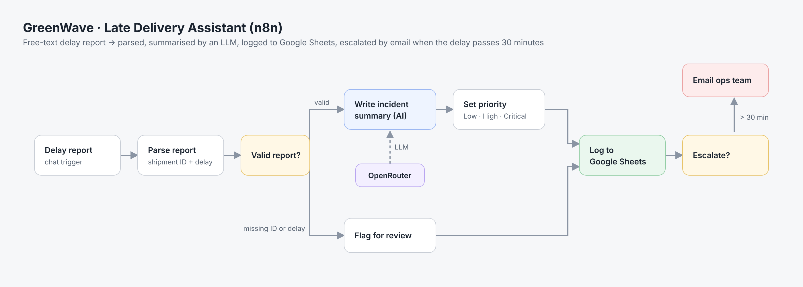

# GreenWave · Late Delivery Assistant (n8n)

An n8n workflow for a logistics company's operations team. A dispatcher types a delay report in plain language, and the workflow turns it into a structured log entry, writes an AI incident summary and emails the ops team when the delay is serious.

## How it works

1. **Delay report received** (chat trigger): for example *"GW-1042 is running 1h 20m late, stuck on the AP-7"*.
2. **Parse report:** extracts the shipment ID (`GW-1234` format) and converts the delay into minutes. It handles minutes, hours and mixed formats like "1h 20m".
3. **Valid report?** If the shipment ID or the delay is missing, the message is logged as **Needs review** instead of being silently dropped.
4. **Write incident summary:** an LLM (via OpenRouter) writes a one-sentence internal summary.
5. **Prepare log fields:** sets the priority: **Critical** at 60 minutes or more, **High** above 30, otherwise **Low**.
6. **Log to Google Sheets:** every report is appended to a log sheet.
7. **Escalate?** Delays over 30 minutes trigger an email to the ops team, with the priority and shipment ID in the subject line.

## Set it up

1. In n8n, go to **Workflows → Import from file** and choose `greenwave-late-delivery.json`.
2. Create a Google Sheet with the headers in `sheet-template.csv`. Paste its ID into the **Log to Google Sheets** node, and connect a Google service account that has edit access to the sheet.
3. Add your OpenRouter credentials to the **OpenRouter Chat Model** node.
4. Add SMTP credentials to the **Email ops team** node and change the example addresses (`alerts@example.com`, `ops@example.com`).
5. Open the chat and send a test report.

## Built with

n8n · LangChain Agent node · OpenRouter (Claude 3.5 Haiku) · Google Sheets API · SMTP

## Notes

GreenWave Logistics is a fictional company. No credentials, sheet IDs or real email addresses are included in this repository.
